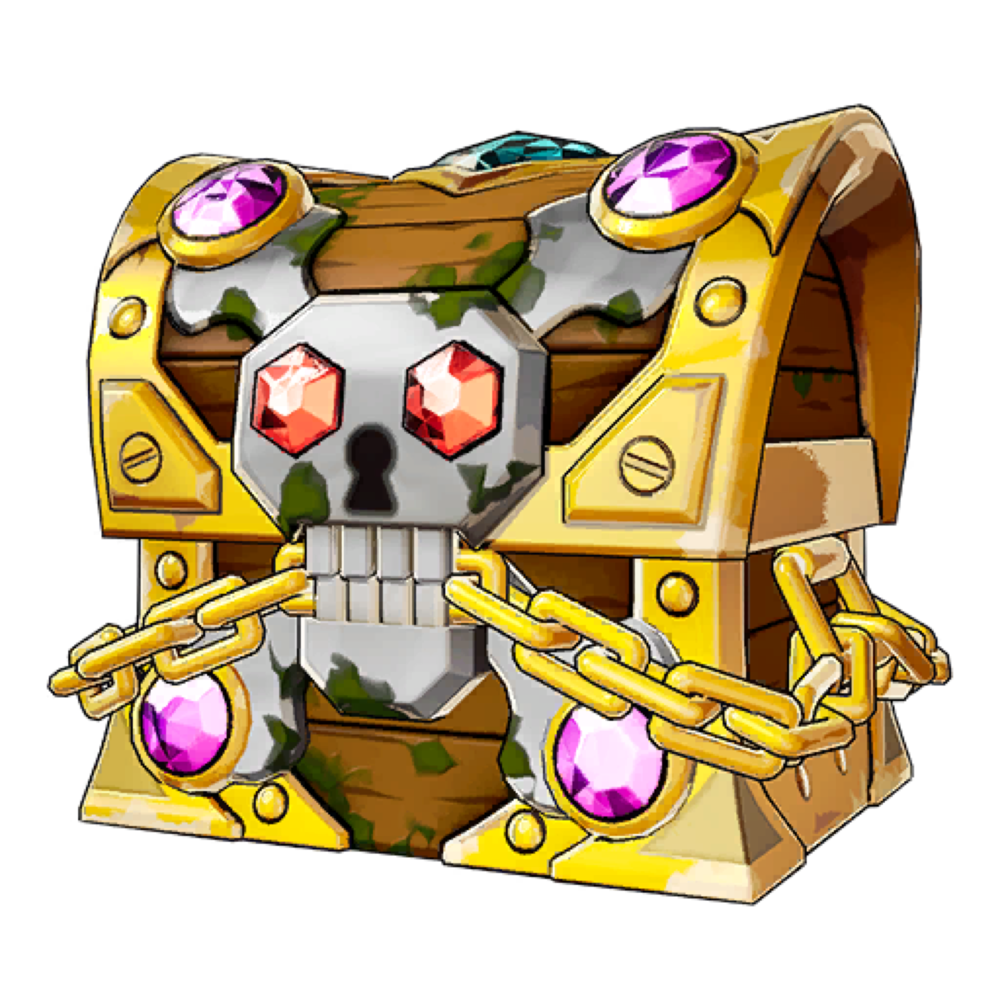
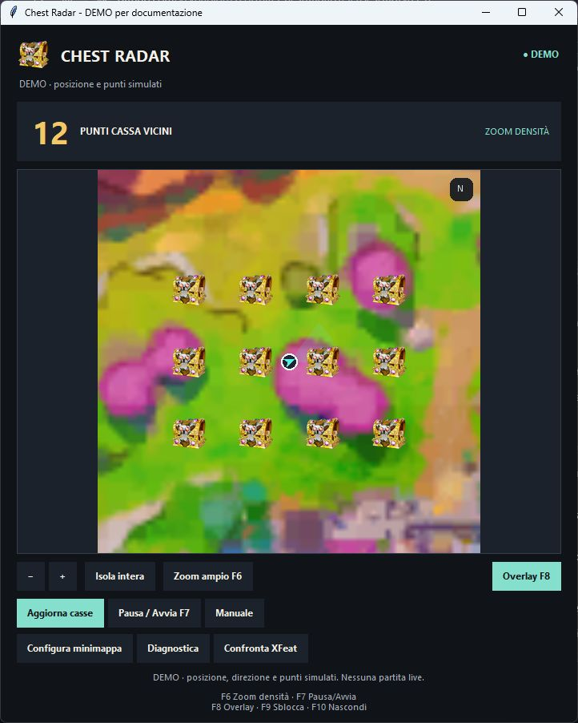
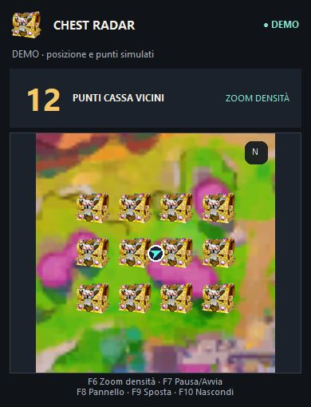

<div align="center">
  
  <h1>Fortnite Chest Radar</h1>
  <p>La mappa dei punti cassa, in un overlay accanto alla partita.</p>
  <p><strong>Windows x64 · v0.2.0 · Sperimentale</strong></p>
  <p>
    <a href="https://github.com/yzypablo67/FortniteChestRadar/releases/latest"><strong>Scarica per Windows</strong></a>
    &nbsp;·&nbsp;
    <a href="GUIDA_CONFIGURAZIONE.md">Guida alla configurazione</a>
    &nbsp;·&nbsp;
    <a href="https://github.com/yzypablo67/FortniteChestRadar/issues/new">Segnala un problema</a>
  </p>
</div>

Chest Radar confronta i **pixel della minimappa** con una mappa di riferimento e mostra i **possibili punti di spawn dei forzieri** nelle vicinanze. Puoi usarlo dal pannello completo oppure come overlay esterno, con zoom che si avvicina nelle zone più dense.

> [!IMPORTANT]
> Le icone indicano punti del dataset: **non confermano che una cassa sia presente, ancora chiusa o sul tuo stesso piano**. Posizione e direzione sono stime. La precisione generale in partita non è stata validata.

## Come si presenta

Le immagini mostrano la vera interfaccia in una **dimostrazione controllata**: posizione, direzione e punti sono simulati. Non sono screenshot di una partita live e non dimostrano la precisione del rilevamento. Clicca sulle immagini per vederle alla dimensione originale.

<table>
  <tr>
    <th>Pannello completo</th>
    <th>Overlay compatto</th>
  </tr>
  <tr>
    <td valign="top"><a href="docs/images/desktop-demo.png"></a></td>
    <td valign="top"><a href="docs/images/overlay-demo.png"></a></td>
  </tr>
  <tr>
    <td>Zoom, aggiornamento dei punti, configurazione della minimappa e diagnostica.</td>
    <td>Vista compatta con mappa locale, punti vicini e scorciatoie.</td>
  </tr>
</table>

## Inizia in quattro passaggi

**Non serve installare Python per usare l'EXE.** Ti servono Windows x64, una cartella scrivibile e una connessione per scaricare mappa e punti.

1. **Scarica ed estrai.** Dalla [release più recente](https://github.com/yzypablo67/FortniteChestRadar/releases/latest), scarica `FortniteChestRadar_0.2.0_Windows_x64.zip` ed estrai **tutta la cartella**. Conserva `_internal` accanto all'EXE.
2. **Seleziona la minimappa.** Apri `Configura.bat`, scegli il monitor e seleziona solo il quadrato della minimappa. Invio conferma; C o Esc annulla. Il giocatore deve essere al centro. Dopo aver salvato, riapri il radar.
3. **Carica i punti.** Avvia `FortniteChestRadar.exe` e premi **Aggiorna casse**. Attendi l'importazione dei dati Fortnite.GG e l'allineamento alla mappa API. Per questo percorso non serve una chiave API.
4. **Passa all'overlay.** Usa Fortnite in **finestra senza bordi** e premi **F8**. Con **F9** sblocchi il pannello e lo trascini dal titolo; premilo di nuovo per bloccarlo.

Se il controllo HUD richiede una conferma, premi **F7 solo quando sei davvero in partita**. Per cambiare monitor, risoluzione o scala HUD, ripeti la selezione della minimappa.

[Apri la guida completa →](GUIDA_CONFIGURAZIONE.md)

## Cosa puoi fare

| Funzione | Comportamento |
| --- | --- |
| **Mappa locale** | Segue la posizione stimata e mantiene il nord in alto. |
| **Zoom in base alla densità** | Più punti nelle vicinanze producono una vista più ravvicinata, fino al limite previsto. |
| **Icone leggibili** | Forziere ricavato dall'immagine originale 1920×1920, senza cerchi neri o linee di collegamento. Le icone restano sulle coordinate 2D. |
| **Direzione** | Legge la freccia bianca della minimappa. Se non è distinguibile, mostra un punto. |
| **Pausa e conferma** | Controllo HUD e letture geometriche coerenti prima di mostrare una posizione automatica. |
| **Diagnostica locale** | Salva il tentativo di riconoscimento per esaminarlo e riprodurlo offline. |

## Tasti rapidi

| Tasto | Azione |
| --- | --- |
| **F6** | Alterna zoom in base alla densità e zoom libero |
| **F7** | Pausa / riprendi; conferma della partita quando richiesta |
| **F8** | Pannello completo / overlay |
| **F9** | Sblocca / blocca l'overlay per spostarlo |
| **F10** | Nascondi / mostra l'overlay |
| **Rotella**, **+**, **−** | Regola lo zoom |

Il pulsante **Manuale** permette di scegliere la posizione con un clic sulla mappa. In caso di conflitti con altre applicazioni, controlla il messaggio delle scorciatoie nel pannello.

## Se qualcosa non funziona

- **Posizione assente o sbagliata:** controlla monitor, ritaglio, modalità e versione della mappa. Il pannello non deve coprire la minimappa originale. Usa **Diagnostica** per salvare il tentativo.
- **Overlay invisibile:** prova **F10**, poi **F8**, e verifica la modalità finestra senza bordi. Il fullscreen esclusivo non è stato validato.
- **Nessuna icona:** completa **Aggiorna casse** e verifica che i punti corrispondano alla mappa. L'assenza di icone non dimostra l'assenza di casse.
- **Molti forzieri nello stesso punto:** punti coincidenti o su piani diversi possono sovrapporsi. Il programma non dispone di quota, piano o proiezione 3D.

Per una segnalazione utile indica versione del programma, risoluzione e scala HUD, modalità di gioco e passaggi per riprodurre il problema. Controlla le catture diagnostiche prima di allegarle: possono mostrare il tuo HUD.

## Stato delle verifiche

**59 test automatici superati**, anche sui sorgenti estratti dallo ZIP. Sono stati verificati avvio dell'EXE, configurazione grafica, risorse incluse e funzioni dell'overlay su un esempio sintetico.

| Verifica | Risultato / limite |
| --- | --- |
| Matching, trasformazioni e rifiuti | Test su terreno sintetico con coordinate note |
| Overlay e interazione | Blocco dei clic, sblocco, ritorno al pannello e ripiego monitor verificati |
| EXE Windows | Avvio e `--self-test` offline superati |
| Precisione in partita | Nessuna validazione generale o nuova prova live della release |
| Prelobby | Filtro implementato; non verificato con una vera cattura di prelobby |
| Compatibilità | Nessuna certificazione anti-cheat o fullscreen esclusivo |

[Leggi il report di verifica](RISULTATI_VERIFICA.txt).

### E XFeat?

**SIFT resta il metodo attivo.** Il pulsante **Confronta XFeat** esegue una prova locale sull'ultima cattura, senza cambiare la posizione live. Il modello ONNX occupa circa **2,7 MB**.

Nel confronto disponibile, SIFT produce un allineamento accettato e XFeat viene rifiutato per supporto insufficiente. Non è dimostrato un miglioramento di precisione. L'orientamento continua a usare il riconoscimento della freccia, non un modello AI. I tempi del confronto non misurano gli FPS del gioco.

## Compilare e verificare i sorgenti

<details>
<summary><strong>Istruzioni per sviluppatori</strong></summary>

La distribuzione è stata costruita su **Windows x64 con Python 3.14**. Dalla cartella del repository:

```powershell
py -3.14 -m venv .venv
.\.venv\Scripts\python.exe -m pip install -r requirements-build.txt
Copy-Item config.example.json config.json
.\.venv\Scripts\python.exe -m unittest discover -s tests -v
.\.venv\Scripts\python.exe radar.py --self-test
.\.venv\Scripts\python.exe build_windows.py
```

Se esiste già un tuo `config.json`, conservalo prima di copiare quello di esempio.

La build produce `dist/FortniteChestRadar/FortniteChestRadar.exe` con risorse, guida e comandi di avvio. La cartella `_internal` è necessaria. `Verifica.bat` nella distribuzione scrive il risultato in `self-test.json`: controlla che contenga `"ok": true`.

I test offline non certificano il funzionamento in una vera partita.

</details>

## Dati, privacy e licenze

Le immagini vengono elaborate localmente. Il programma **non accede alla memoria del gioco**, non invia comandi al gioco e non carica screenshot online. Scarica mappa e punti da servizi esterni. Le immagini di questa documentazione mostrano una demo, senza catture personali di partita.

Il repository e gli archivi pubblici escludono chiavi API, calibrazione e cache personali. La build non è firmata: controlla provenienza e [checksum della release](https://github.com/yzypablo67/FortniteChestRadar/releases/latest).

Codice del progetto: [MIT](LICENSE). Modello XFeat e componenti terzi mantengono le proprie licenze; immagine del forziere e grafica della mappa sono escluse dalla licenza MIT. Vedi [attribuzioni](THIRD_PARTY.md) e [provenienza delle immagini](docs/images/README.md).

Progetto indipendente, senza affiliazione con Epic Games o Fortnite.GG. Sviluppato con assistenza di strumenti AI.
